# Genera font specimens

<!-- Generated by scripts/update_specimen_gallery.py; do not edit by hand. -->

These 89 deterministic specimens cover every font resident in the pinned
Genera 8.5 base world. Latin-capable fonts use the project pangram; specialty
repertoires use complete Unicode-addressed glyph sheets. The source PNGs preserve
the recovered one-bit geometry without smoothing. Click any thumbnail to inspect
the full-resolution image; GitHub may scale thumbnails to fit the gallery.
Resident strike names are followed by their primary `FAMILY/FACE/SIZE` selector.
Specialty labels also show the character set and isolated desktop family;
role-only and genuinely unmapped strikes are labelled explicitly.

[Latin-capable fonts (78)](#latin-capable-fonts-78) ·
[Specialty repertoires (11)](#specialty-repertoires-11) ·
[Machine-readable manifest](specimens/MANIFEST.json)

## Latin-capable fonts (78)

<table>
  <tbody>
    <tr>
      <td align="center" width="50%">
        <a href="specimens/latin/40vr.png">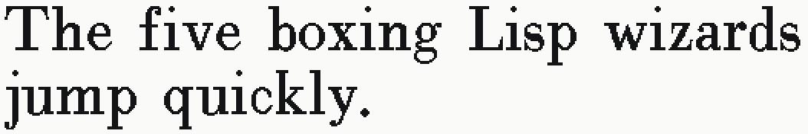</a> 
        <a href="specimens/latin/40vr.png"><code>40VR</code></a> 
        <small><code>unmapped resident strike</code></small> 
        1054&times;176 &middot; pangram
      </td>
      <td align="center" width="50%">
        <a href="specimens/latin/5x5.png">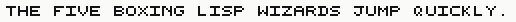</a> 
        <a href="specimens/latin/5x5.png"><code>5X5</code></a> 
        <small><code>FIX/UPPERCASE/VERY-SMALL</code></small> 
        516&times;22 &middot; pangram
      </td>
    </tr>
    <tr>
      <td align="center" width="50%">
         
        <a href="specimens/latin/bigfnt.png"><code>BIGFNT</code></a> 
        <small><code>FIX/ROMAN/VERY-LARGE</code></small> 
        1020&times;52 &middot; pangram
      </td>
      <td align="center" width="50%">
         
        <a href="specimens/latin/bigfntb.png"><code>BIGFNTB</code></a> 
        <small><code>FIX/BOLD/VERY-LARGE</code></small> 
        1104&times;52 &middot; pangram
      </td>
    </tr>
    <tr>
      <td align="center" width="50%">
        <a href="specimens/latin/bigfntbi.png">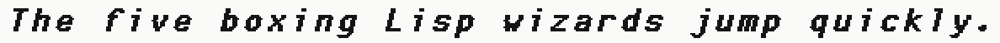</a> 
        <a href="specimens/latin/bigfntbi.png"><code>BIGFNTBI</code></a> 
        <small><code>FIX/BOLD-ITALIC/VERY-LARGE</code></small> 
        1188&times;52 &middot; pangram
      </td>
      <td align="center" width="50%">
        <a href="specimens/latin/bigfnti.png">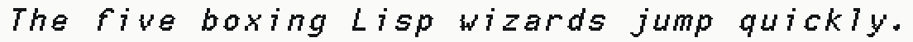</a> 
        <a href="specimens/latin/bigfnti.png"><code>BIGFNTI</code></a> 
        <small><code>FIX/ITALIC/VERY-LARGE</code></small> 
        1104&times;52 &middot; pangram
      </td>
    </tr>
    <tr>
      <td align="center" width="50%">
        <a href="specimens/latin/cptfont.png">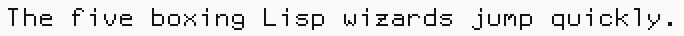</a> 
        <a href="specimens/latin/cptfont.png"><code>CPTFONT</code></a> 
        <small><code>FIX/ROMAN/NORMAL</code></small> 
        684&times;36 &middot; pangram
      </td>
      <td align="center" width="50%">
        <a href="specimens/latin/cptfontb.png">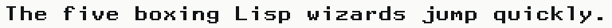</a> 
        <a href="specimens/latin/cptfontb.png"><code>CPTFONTB</code></a> 
        <small><code>FIX/BOLD-EXTENDED/NORMAL</code></small> 
        768&times;36 &middot; pangram
      </td>
    </tr>
    <tr>
      <td align="center" width="50%">
        <a href="specimens/latin/cptfontbi.png">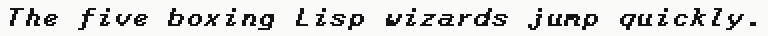</a> 
        <a href="specimens/latin/cptfontbi.png"><code>CPTFONTBI</code></a> 
        <small><code>FIX/BOLD-ITALIC/NORMAL</code></small> 
        768&times;36 &middot; pangram
      </td>
      <td align="center" width="50%">
        <a href="specimens/latin/cptfontc.png">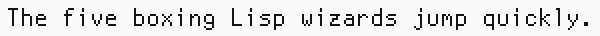</a> 
        <a href="specimens/latin/cptfontc.png"><code>CPTFONTC</code></a> 
        <small><code>FIX/CONDENSED/NORMAL</code></small> 
        600&times;36 &middot; pangram
      </td>
    </tr>
    <tr>
      <td align="center" width="50%">
        <a href="specimens/latin/cptfontcb.png">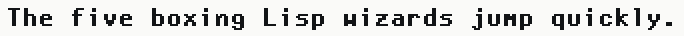</a> 
        <a href="specimens/latin/cptfontcb.png"><code>CPTFONTCB</code></a> 
        <small><code>FIX/BOLD/NORMAL</code></small> 
        684&times;36 &middot; pangram
      </td>
      <td align="center" width="50%">
        <a href="specimens/latin/cptfontcc.png">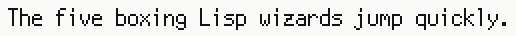</a> 
        <a href="specimens/latin/cptfontcc.png"><code>CPTFONTCC</code></a> 
        <small><code>FIX/EXTRA-CONDENSED/NORMAL</code></small> 
        516&times;36 &middot; pangram
      </td>
    </tr>
    <tr>
      <td align="center" width="50%">
        <a href="specimens/latin/cptfonti.png">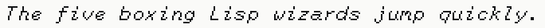</a> 
        <a href="specimens/latin/cptfonti.png"><code>CPTFONTI</code></a> 
        <small><code>FIX/ITALIC/NORMAL</code></small> 
        684&times;36 &middot; pangram
      </td>
      <td align="center" width="50%">
        <a href="specimens/latin/dutch14.png">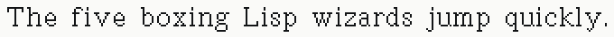</a> 
        <a href="specimens/latin/dutch14.png"><code>DUTCH14</code></a> 
        <small><code>DUTCH/ROMAN/LARGE</code></small> 
        680&times;42 &middot; pangram
      </td>
    </tr>
    <tr>
      <td align="center" width="50%">
        <a href="specimens/latin/dutch14b.png">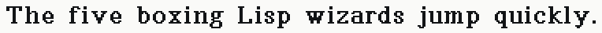</a> 
        <a href="specimens/latin/dutch14b.png"><code>DUTCH14B</code></a> 
        <small><code>DUTCH/BOLD/LARGE</code></small> 
        764&times;42 &middot; pangram
      </td>
      <td align="center" width="50%">
        <a href="specimens/latin/dutch14bi.png">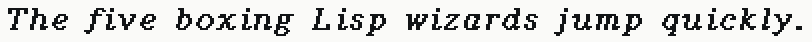</a> 
        <a href="specimens/latin/dutch14bi.png"><code>DUTCH14BI</code></a> 
        <small><code>DUTCH/BOLD-ITALIC/LARGE</code></small> 
        812&times;42 &middot; pangram
      </td>
    </tr>
    <tr>
      <td align="center" width="50%">
        <a href="specimens/latin/dutch14i.png">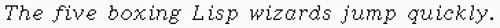</a> 
        <a href="specimens/latin/dutch14i.png"><code>DUTCH14I</code></a> 
        <small><code>DUTCH/ITALIC/LARGE</code></small> 
        728&times;42 &middot; pangram
      </td>
      <td align="center" width="50%">
        <a href="specimens/latin/dutch20.png">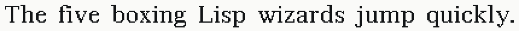</a> 
        <a href="specimens/latin/dutch20.png"><code>DUTCH20</code></a> 
        <small><code>DUTCH/ROMAN/VERY-LARGE</code></small> 
        860&times;52 &middot; pangram
      </td>
    </tr>
    <tr>
      <td align="center" width="50%">
         
        <a href="specimens/latin/dutch20b.png"><code>DUTCH20B</code></a> 
        <small><code>DUTCH/BOLD/VERY-LARGE</code></small> 
        940&times;52 &middot; pangram
      </td>
      <td align="center" width="50%">
        <a href="specimens/latin/dutch20bi.png">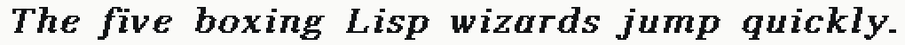</a> 
        <a href="specimens/latin/dutch20bi.png"><code>DUTCH20BI</code></a> 
        <small><code>DUTCH/BOLD-ITALIC/VERY-LARGE</code></small> 
        1020&times;52 &middot; pangram
      </td>
    </tr>
    <tr>
      <td align="center" width="50%">
        <a href="specimens/latin/dutch20i.png">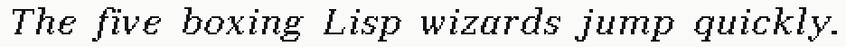</a> 
        <a href="specimens/latin/dutch20i.png"><code>DUTCH20I</code></a> 
        <small><code>DUTCH/ITALIC/VERY-LARGE</code></small> 
        936&times;52 &middot; pangram
      </td>
      <td align="center" width="50%">
        <a href="specimens/latin/einy7.png">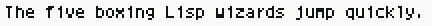</a> 
        <a href="specimens/latin/einy7.png"><code>EINY7</code></a> 
        <small><code>FIX/ROMAN/VERY-SMALL</code></small> 
        432&times;26 &middot; pangram
      </td>
    </tr>
    <tr>
      <td align="center" width="50%">
        <a href="specimens/latin/einy8.png">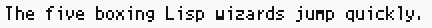</a> 
        <a href="specimens/latin/einy8.png"><code>EINY8</code></a> 
        <small><code>unmapped resident strike</code></small> 
        432&times;28 &middot; pangram
      </td>
      <td align="center" width="50%">
        <a href="specimens/latin/eurex21i.png">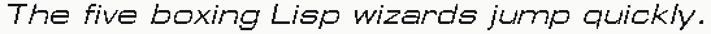</a> 
        <a href="specimens/latin/eurex21i.png"><code>EUREX21I</code></a> 
        <small><code>EUREX/ITALIC/VERY-LARGE</code></small> 
        1094&times;54 &middot; pangram
      </td>
    </tr>
    <tr>
      <td align="center" width="50%">
        <a href="specimens/latin/eurex24i.png">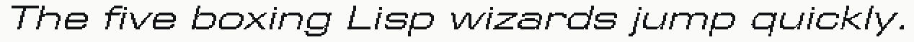</a> 
        <a href="specimens/latin/eurex24i.png"><code>EUREX24I</code></a> 
        <small><code>EUREX/ITALIC/HUGE</code></small> 
        1268&times;60 &middot; pangram
      </td>
      <td align="center" width="50%">
        <a href="specimens/latin/hl10.png">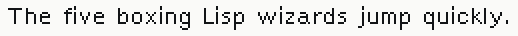</a> 
        <a href="specimens/latin/hl10.png"><code>HL10</code></a> 
        <small><code>SWISS/ROMAN/SMALL</code></small> 
        518&times;36 &middot; pangram
      </td>
    </tr>
    <tr>
      <td align="center" width="50%">
        <a href="specimens/latin/hl10b.png">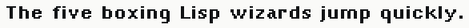</a> 
        <a href="specimens/latin/hl10b.png"><code>HL10B</code></a> 
        <small><code>SWISS/BOLD/SMALL</code></small> 
        586&times;36 &middot; pangram
      </td>
      <td align="center" width="50%">
        <a href="specimens/latin/hl10bi.png">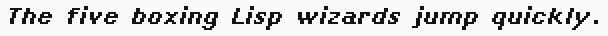</a> 
        <a href="specimens/latin/hl10bi.png"><code>HL10BI</code></a> 
        <small><code>SWISS/BOLD-ITALIC/SMALL</code></small> 
        608&times;36 &middot; pangram
      </td>
    </tr>
    <tr>
      <td align="center" width="50%">
        <a href="specimens/latin/hl10i.png">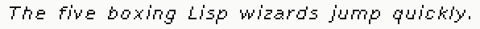</a> 
        <a href="specimens/latin/hl10i.png"><code>HL10I</code></a> 
        <small><code>SWISS/ITALIC/SMALL</code></small> 
        596&times;36 &middot; pangram
      </td>
      <td align="center" width="50%">
        <a href="specimens/latin/hl12.png">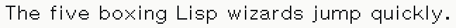</a> 
        <a href="specimens/latin/hl12.png"><code>HL12</code></a> 
        <small><code>SWISS/ROMAN/NORMAL</code></small> 
        648&times;40 &middot; pangram
      </td>
    </tr>
    <tr>
      <td align="center" width="50%">
        <a href="specimens/latin/hl12b.png">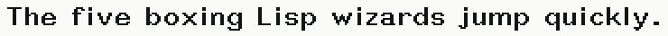</a> 
        <a href="specimens/latin/hl12b.png"><code>HL12B</code></a> 
        <small><code>SWISS/BOLD/NORMAL</code></small> 
        740&times;40 &middot; pangram
      </td>
      <td align="center" width="50%">
        <a href="specimens/latin/hl12bi.png">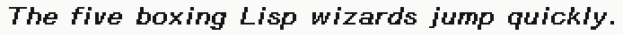</a> 
        <a href="specimens/latin/hl12bi.png"><code>HL12BI</code></a> 
        <small><code>SWISS/BOLD-ITALIC/NORMAL</code></small> 
        694&times;40 &middot; pangram
      </td>
    </tr>
    <tr>
      <td align="center" width="50%">
        <a href="specimens/latin/hl12i.png">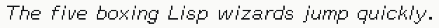</a> 
        <a href="specimens/latin/hl12i.png"><code>HL12I</code></a> 
        <small><code>SWISS/ITALIC/NORMAL</code></small> 
        626&times;40 &middot; pangram
      </td>
      <td align="center" width="50%">
        <a href="specimens/latin/hl14.png">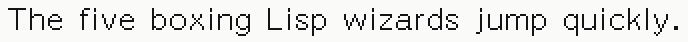</a> 
        <a href="specimens/latin/hl14.png"><code>HL14</code></a> 
        <small><code>SWISS/ROMAN/LARGE</code></small> 
        688&times;42 &middot; pangram
      </td>
    </tr>
    <tr>
      <td align="center" width="50%">
        <a href="specimens/latin/hl14b.png">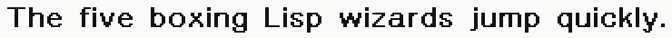</a> 
        <a href="specimens/latin/hl14b.png"><code>HL14B</code></a> 
        <small><code>SWISS/BOLD/LARGE</code></small> 
        740&times;42 &middot; pangram
      </td>
      <td align="center" width="50%">
        <a href="specimens/latin/hl14bi.png">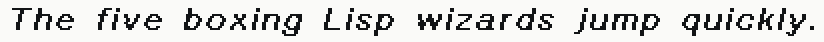</a> 
        <a href="specimens/latin/hl14bi.png"><code>HL14BI</code></a> 
        <small><code>SWISS/BOLD-ITALIC/LARGE</code></small> 
        824&times;42 &middot; pangram
      </td>
    </tr>
    <tr>
      <td align="center" width="50%">
        <a href="specimens/latin/hl14i.png">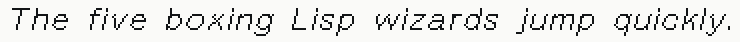</a> 
        <a href="specimens/latin/hl14i.png"><code>HL14I</code></a> 
        <small><code>SWISS/ITALIC/LARGE</code></small> 
        740&times;42 &middot; pangram
      </td>
      <td align="center" width="50%">
        <a href="specimens/latin/hl8.png">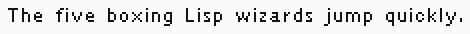</a> 
        <a href="specimens/latin/hl8.png"><code>HL8</code></a> 
        <small><code>SWISS/ROMAN/VERY-SMALL</code></small> 
        470&times;34 &middot; pangram
      </td>
    </tr>
    <tr>
      <td align="center" width="50%">
        <a href="specimens/latin/hl8b.png">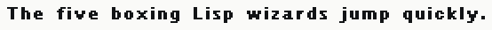</a> 
        <a href="specimens/latin/hl8b.png"><code>HL8B</code></a> 
        <small><code>SWISS/BOLD/VERY-SMALL</code></small> 
        554&times;34 &middot; pangram
      </td>
      <td align="center" width="50%">
        <a href="specimens/latin/hl8bi.png">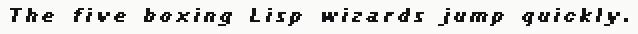</a> 
        <a href="specimens/latin/hl8bi.png"><code>HL8BI</code></a> 
        <small><code>SWISS/BOLD-ITALIC/VERY-SMALL</code></small> 
        638&times;34 &middot; pangram
      </td>
    </tr>
    <tr>
      <td align="center" width="50%">
        <a href="specimens/latin/hl8i.png">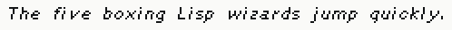</a> 
        <a href="specimens/latin/hl8i.png"><code>HL8I</code></a> 
        <small><code>SWISS/ITALIC/VERY-SMALL</code></small> 
        498&times;34 &middot; pangram
      </td>
      <td align="center" width="50%">
        <a href="specimens/latin/jess11.png">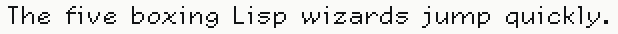</a> 
        <a href="specimens/latin/jess11.png"><code>JESS11</code></a> 
        <small><code>JESS/ROMAN/SMALL</code></small> 
        618&times;34 &middot; pangram
      </td>
    </tr>
    <tr>
      <td align="center" width="50%">
        <a href="specimens/latin/jess11b.png">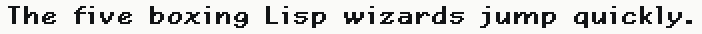</a> 
        <a href="specimens/latin/jess11b.png"><code>JESS11B</code></a> 
        <small><code>JESS/BOLD/SMALL</code></small> 
        702&times;34 &middot; pangram
      </td>
      <td align="center" width="50%">
        <a href="specimens/latin/jess11i.png">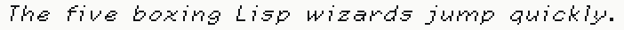</a> 
        <a href="specimens/latin/jess11i.png"><code>JESS11I</code></a> 
        <small><code>JESS/ITALIC/SMALL</code></small> 
        702&times;34 &middot; pangram
      </td>
    </tr>
    <tr>
      <td align="center" width="50%">
        <a href="specimens/latin/jess13.png">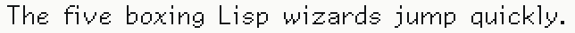</a> 
        <a href="specimens/latin/jess13.png"><code>JESS13</code></a> 
        <small><code>JESS/ROMAN/NORMAL</code></small> 
        644&times;38 &middot; pangram
      </td>
      <td align="center" width="50%">
         
        <a href="specimens/latin/jess13b.png"><code>JESS13B</code></a> 
        <small><code>JESS/BOLD/NORMAL</code></small> 
        684&times;38 &middot; pangram
      </td>
    </tr>
    <tr>
      <td align="center" width="50%">
        <a href="specimens/latin/jess13i.png">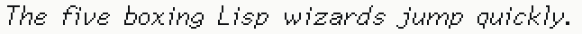</a> 
        <a href="specimens/latin/jess13i.png"><code>JESS13I</code></a> 
        <small><code>JESS/ITALIC/NORMAL</code></small> 
        646&times;38 &middot; pangram
      </td>
      <td align="center" width="50%">
        <a href="specimens/latin/jess14.png">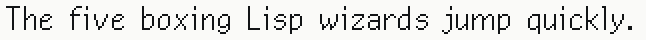</a> 
        <a href="specimens/latin/jess14.png"><code>JESS14</code></a> 
        <small><code>JESS/ROMAN/LARGE</code></small> 
        646&times;40 &middot; pangram
      </td>
    </tr>
    <tr>
      <td align="center" width="50%">
        <a href="specimens/latin/jess14b.png">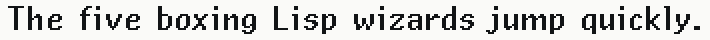</a> 
        <a href="specimens/latin/jess14b.png"><code>JESS14B</code></a> 
        <small><code>JESS/BOLD/LARGE</code></small> 
        710&times;40 &middot; pangram
      </td>
      <td align="center" width="50%">
        <a href="specimens/latin/jess14i.png">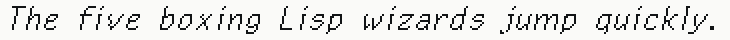</a> 
        <a href="specimens/latin/jess14i.png"><code>JESS14I</code></a> 
        <small><code>JESS/ITALIC/LARGE</code></small> 
        730&times;40 &middot; pangram
      </td>
    </tr>
    <tr>
      <td align="center" width="50%">
        <a href="specimens/latin/medfnt.png">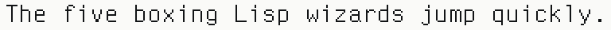</a> 
        <a href="specimens/latin/medfnt.png"><code>MEDFNT</code></a> 
        <small><code>FIX/ROMAN/LARGE</code></small> 
        768&times;38 &middot; pangram
      </td>
      <td align="center" width="50%">
        <a href="specimens/latin/medfntb.png">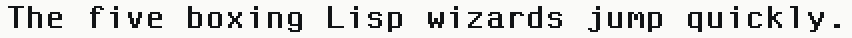</a> 
        <a href="specimens/latin/medfntb.png"><code>MEDFNTB</code></a> 
        <small><code>FIX/BOLD/LARGE</code></small> 
        852&times;38 &middot; pangram
      </td>
    </tr>
    <tr>
      <td align="center" width="50%">
        <a href="specimens/latin/medfntbi.png">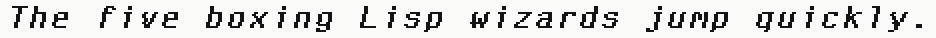</a> 
        <a href="specimens/latin/medfntbi.png"><code>MEDFNTBI</code></a> 
        <small><code>FIX/BOLD-ITALIC/LARGE</code></small> 
        936&times;38 &middot; pangram
      </td>
      <td align="center" width="50%">
        <a href="specimens/latin/medfnti.png">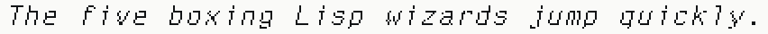</a> 
        <a href="specimens/latin/medfnti.png"><code>MEDFNTI</code></a> 
        <small><code>FIX/ITALIC/LARGE</code></small> 
        852&times;38 &middot; pangram
      </td>
    </tr>
    <tr>
      <td align="center" width="50%">
         
        <a href="specimens/latin/swiss12-ccaps.png"><code>SWISS12-CCAPS</code></a> 
        <small><code>SWISS/CONDENSED-CAPS/NORMAL</code></small> 
        642&times;40 &middot; pangram
      </td>
      <td align="center" width="50%">
         
        <a href="specimens/latin/swiss12b-ccaps.png"><code>SWISS12B-CCAPS</code></a> 
        <small><code>SWISS/BOLD-CONDENSED-CAPS/NORMAL</code></small> 
        728&times;40 &middot; pangram
      </td>
    </tr>
    <tr>
      <td align="center" width="50%">
         
        <a href="specimens/latin/swiss20.png"><code>SWISS20</code></a> 
        <small><code>SWISS/ROMAN/VERY-LARGE</code></small> 
        878&times;52 &middot; pangram
      </td>
      <td align="center" width="50%">
         
        <a href="specimens/latin/swiss20b.png"><code>SWISS20B</code></a> 
        <small><code>SWISS/BOLD/VERY-LARGE</code></small> 
        962&times;52 &middot; pangram
      </td>
    </tr>
    <tr>
      <td align="center" width="50%">
         
        <a href="specimens/latin/swiss20bi.png"><code>SWISS20BI</code></a> 
        <small><code>SWISS/BOLD-ITALIC/VERY-LARGE</code></small> 
        1046&times;52 &middot; pangram
      </td>
      <td align="center" width="50%">
         
        <a href="specimens/latin/swiss20i.png"><code>SWISS20I</code></a> 
        <small><code>SWISS/ITALIC/VERY-LARGE</code></small> 
        962&times;52 &middot; pangram
      </td>
    </tr>
    <tr>
      <td align="center" width="50%">
         
        <a href="specimens/latin/tiny.png"><code>TINY</code></a> 
        <small><code>FIX/ROMAN/TINY</code></small> 
        348&times;24 &middot; pangram
      </td>
      <td align="center" width="50%">
         
        <a href="specimens/latin/tr10.png"><code>TR10</code></a> 
        <small><code>DUTCH/ROMAN/SMALL</code></small> 
        530&times;36 &middot; pangram
      </td>
    </tr>
    <tr>
      <td align="center" width="50%">
         
        <a href="specimens/latin/tr10b.png"><code>TR10B</code></a> 
        <small><code>DUTCH/BOLD/SMALL</code></small> 
        566&times;36 &middot; pangram
      </td>
      <td align="center" width="50%">
         
        <a href="specimens/latin/tr10bi.png"><code>TR10BI</code></a> 
        <small><code>DUTCH/BOLD-ITALIC/SMALL</code></small> 
        612&times;36 &middot; pangram
      </td>
    </tr>
    <tr>
      <td align="center" width="50%">
         
        <a href="specimens/latin/tr10i.png"><code>TR10I</code></a> 
        <small><code>DUTCH/ITALIC/SMALL</code></small> 
        528&times;36 &middot; pangram
      </td>
      <td align="center" width="50%">
         
        <a href="specimens/latin/tr12.png"><code>TR12</code></a> 
        <small><code>DUTCH/ROMAN/NORMAL</code></small> 
        628&times;40 &middot; pangram
      </td>
    </tr>
    <tr>
      <td align="center" width="50%">
         
        <a href="specimens/latin/tr12b.png"><code>TR12B</code></a> 
        <small><code>DUTCH/BOLD/NORMAL</code></small> 
        658&times;44 &middot; pangram
      </td>
      <td align="center" width="50%">
         
        <a href="specimens/latin/tr12bi.png"><code>TR12BI</code></a> 
        <small><code>DUTCH/BOLD-ITALIC/NORMAL</code></small> 
        692&times;40 &middot; pangram
      </td>
    </tr>
    <tr>
      <td align="center" width="50%">
         
        <a href="specimens/latin/tr12i.png"><code>TR12I</code></a> 
        <small><code>DUTCH/ITALIC/NORMAL</code></small> 
        612&times;40 &middot; pangram
      </td>
      <td align="center" width="50%">
         
        <a href="specimens/latin/tr8.png"><code>TR8</code></a> 
        <small><code>DUTCH/ROMAN/VERY-SMALL</code></small> 
        458&times;32 &middot; pangram
      </td>
    </tr>
    <tr>
      <td align="center" width="50%">
         
        <a href="specimens/latin/tr8b.png"><code>TR8B</code></a> 
        <small><code>DUTCH/BOLD/VERY-SMALL</code></small> 
        542&times;34 &middot; pangram
      </td>
      <td align="center" width="50%">
         
        <a href="specimens/latin/tr8bi.png"><code>TR8BI</code></a> 
        <small><code>DUTCH/BOLD-ITALIC/VERY-SMALL</code></small> 
        626&times;34 &middot; pangram
      </td>
    </tr>
    <tr>
      <td align="center" width="50%">
         
        <a href="specimens/latin/tr8i.png"><code>TR8I</code></a> 
        <small><code>DUTCH/ITALIC/VERY-SMALL</code></small> 
        510&times;32 &middot; pangram
      </td>
      <td align="center" width="50%">
         
        <a href="specimens/latin/tvfont.png"><code>TVFONT</code></a> 
        <small><code>FIX/ROMAN/SMALL</code></small> 
        516&times;32 &middot; pangram
      </td>
    </tr>
    <tr>
      <td align="center" width="50%">
         
        <a href="specimens/latin/tvfontb.png"><code>TVFONTB</code></a> 
        <small><code>FIX/BOLD-EXTENDED/SMALL</code></small> 
        600&times;32 &middot; pangram
      </td>
      <td align="center" width="50%">
         
        <a href="specimens/latin/tvfontbi.png"><code>TVFONTBI</code></a> 
        <small><code>FIX/BOLD-ITALIC/SMALL</code></small> 
        684&times;32 &middot; pangram
      </td>
    </tr>
    <tr>
      <td align="center" width="50%">
         
        <a href="specimens/latin/tvfontcb.png"><code>TVFONTCB</code></a> 
        <small><code>FIX/BOLD/SMALL</code></small> 
        516&times;32 &middot; pangram
      </td>
      <td align="center" width="50%">
         
        <a href="specimens/latin/tvfonti.png"><code>TVFONTI</code></a> 
        <small><code>FIX/ITALIC/SMALL</code></small> 
        600&times;32 &middot; pangram
      </td>
    </tr>
  </tbody>
</table>

## Specialty repertoires (11)

<table>
  <tbody>
    <tr>
      <td align="center" width="50%">
         
        <a href="specimens/symbols/boxfont.png"><code>BOXFONT</code></a> 
        <small><code>Symbolics Genera Box Font (role-mapped)</code></small> 
        385&times;305 &middot; boxfont glyph sheet
      </td>
      <td align="center" width="50%">
         
        <a href="specimens/symbols/edsymbol12.png"><code>EDSYMBOL12</code></a> 
        <small><code>Symbolics Genera Editor Symbols (role-mapped)</code></small> 
        641&times;43 &middot; editor symbols glyph sheet
      </td>
    </tr>
    <tr>
      <td align="center" width="50%">
         
        <a href="specimens/symbols/hippo10.png"><code>HIPPO10</code></a> 
        <small><code>Symbolics Genera Greek (role-mapped)</code></small> 
        545&times;265 &middot; greek glyph sheet
      </td>
      <td align="center" width="50%">
         
        <a href="specimens/symbols/hippo12.png"><code>HIPPO12</code></a> 
        <small><code>Symbolics Genera Greek (role-mapped)</code></small> 
        513&times;295 &middot; greek glyph sheet
      </td>
    </tr>
    <tr>
      <td align="center" width="50%">
         
        <a href="specimens/symbols/math10.png"><code>MATH10</code></a> 
        <small><code>Symbolics Genera Math (role-mapped)</code></small> 
        609&times;277 &middot; math glyph sheet
      </td>
      <td align="center" width="50%">
         
        <a href="specimens/symbols/math12.png"><code>MATH12</code></a> 
        <small><code>Symbolics Genera Math (role-mapped)</code></small> 
        577&times;295 &middot; math glyph sheet
      </td>
    </tr>
    <tr>
      <td align="center" width="50%">
         
        <a href="specimens/symbols/mouse.png"><code>MOUSE</code></a> 
        <small><code>FIX/ROMAN/NORMAL [MOUSE] · Symbolics Genera Mouse (role-mapped)</code></small> 
        1121&times;185 &middot; mouse glyph sheet
      </td>
      <td align="center" width="50%">
         
        <a href="specimens/symbols/narrow.png"><code>NARROW</code></a> 
        <small><code>FIX/ROMAN/NORMAL [ARROW] · Symbolics Genera Arrows (role-mapped)</code></small> 
        609&times;77 &middot; arrow glyph sheet
      </td>
    </tr>
    <tr>
      <td align="center" width="50%">
         
        <a href="specimens/symbols/symbol10.png"><code>SYMBOL10</code></a> 
        <small><code>Symbolics Genera Symbols (role-mapped)</code></small> 
        1313&times;385 &middot; symbol glyph sheet
      </td>
      <td align="center" width="50%">
         
        <a href="specimens/symbols/symbol12.png"><code>SYMBOL12</code></a> 
        <small><code>SWISS/ROMAN/NORMAL [SYMBOL] · Symbolics Genera Symbols (role-mapped)</code></small> 
        673&times;211 &middot; symbol glyph sheet
      </td>
    </tr>
    <tr>
      <td align="center" width="50%">
         
        <a href="specimens/symbols/vt100.png"><code>VT100</code></a> 
        <small><code>unmapped resident strike</code></small> 
        353&times;229 &middot; vt100 glyph sheet
      </td>
      <td width="50%"></td>
    </tr>
  </tbody>
</table>
